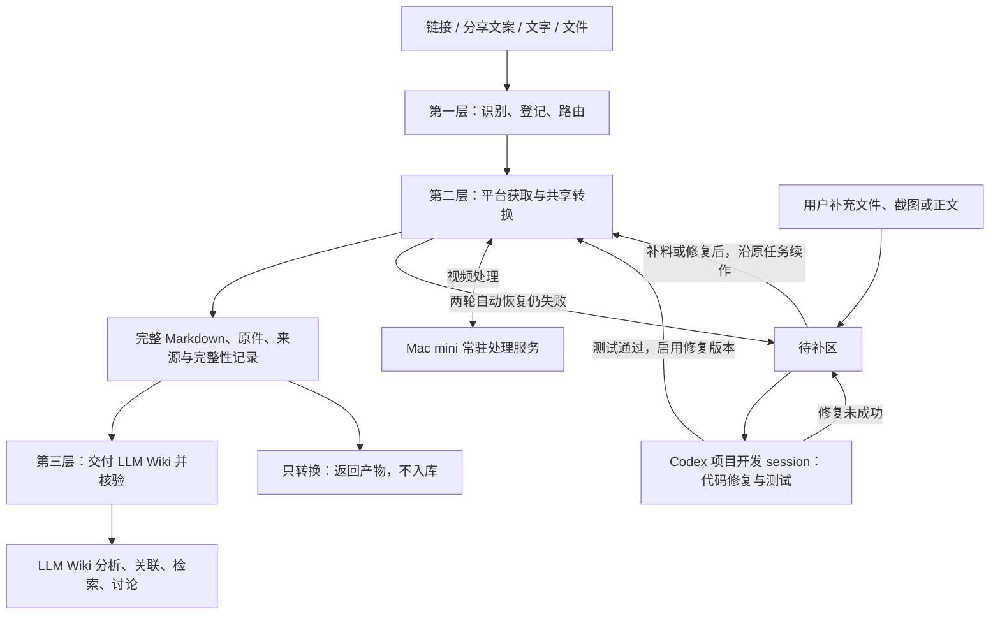

# 三层资料摄取与自动维护规格

日期：2026-11-16（Asia/Shanghai）。依据：本次 Q1–Q15 访谈及项目已有数据边界。

状态：需求访谈完成，规格已整理并发布为 [GitHub SPEC #40](https://github.com/liunoly-design/Personal_wiki/issues/40)，标签 ready-for-agent；正文与标签已读回核验。本文件描述目标行为，不代表已实现、已部署或已完成真实平台验收。不预设新的发布版本号。

## Problem Statement

用户希望把 X 帖子、抖音分享文案、公众号文章，以及之后增加的网站、图文、音视频或文件交给 AI，直接得到完整 Markdown，并存入个人 LLM Wiki。不同平台需要不同获取方法；只保存标题、简介或摘要不能满足全文阅读与知识复用。

现有流程混合了入口指令、平台获取、模型加工和知识写入，且有多套历史代码与部署记录。平台变化后，用户还需要处理未完成资料、修复采集方式并重新提交。新架构需要独立、可扩展的来源处理能力，以及持续保存进度、自动维护和补处理的闭环。

## Solution

提供供 AI 调用的资料摄取能力。主流程分为三层：第一层识别和路由，第二层按来源获取完整内容并转换为 Markdown，第三层可靠交付给 LLM Wiki，由 LLM Wiki 承担知识分析、关联、检索和讨论。CLI 作为执行底座，skill 作为调用说明，是本规格采用的实施设计；具体命令拼写不代表当前已有命令。

首批验收 X、抖音、微信公众号，保留纯文字入口；随后接入普通网页和小红书；其他来源按确定的顺序逐项扩展。收到尚未接入的平台链接时先尝试已有通用方法，失败则登记待补与待支持平台，不因一条链接自动开启新平台开发。

### 确认状态

| 类别 | 口径 |
| --- | --- |
| 已确认需求 | 三层职责、全文 Markdown、自动切换获取方式、GitHub 库优先、Codex/自动化兜底、图文文字识别、视频语音转录、Mac mini 后台视频处理、只转换、待补与手工补料、自动维护及来源顺序 |
| Q14 最终澄清 | 日常任务两轮自动恢复仍失败后进入待补，随后调用 Codex 项目开发 session 修复代码、测试并补处理；两轮上限不取消开发 session 的后续修复 |
| 本规格的实施设计 | CLI 配合 skill、平台获取器复用共享转换、持久任务与阶段状态、统一交付包、故障聚合、开发 session 交接与版本化启用 |
| 待工程核验 | 各库实际兼容性、服务端真实接口、session 调度桥接、LLM Wiki 接入与保护方式、ASR/OCR 性能；这些不是已交付能力 |

## User Stories

1. 作为用户，我希望把 X 链接交给 AI 并要求记录，以便直接归档内容。
2. 作为用户，我希望直接粘贴抖音完整分享文案，以便无需先手动清理短链和分享口令。
3. 作为用户，我希望发送公众号文章链接，以便得到完整文章 Markdown。
4. 作为用户，我希望直接记录一段自己的文字，以便保留原话并交给 Wiki 关联。
5. 作为用户，我希望个人补充说明与来源正文分开，以便区分作者表达和我的判断。
6. 作为用户，我希望同一消息内多个目标各自处理，以便单条失败不阻止其他资料。
7. 作为用户，我希望系统识别平台与内容形态，以便图文、视频和文章选择合适方法。
8. 作为用户，我希望不同平台可以使用不同获取工具，以便持续增加来源。
9. 作为用户，我希望优先使用已有 GitHub 库并验证样本，以便复用成熟能力。
10. 作为用户，我希望某种获取方式失败后自动切换，以便减少手动尝试。
11. 作为用户，我希望必要时使用已授权的 Codex session 或自动化，以便补充常规工具不足。
12. 作为用户，我希望正文保持完整和原有顺序，以便摘要不会代替全文。
13. 作为用户，我希望图片与正文的对应关系保留，以便核对图文内容。
14. 作为用户，我希望识别图文图片中的文字，以便图片承载的正文也可阅读和检索。
15. 作为用户，我希望图文识别的不确定处明确标记，以便不会把猜测当原文。
16. 作为用户，我希望视频生成完整语音转录，以便阅读视频中的全部讲话。
17. 作为用户，我希望视频、音频和转录属于同一来源，以便统一追溯而非重复计为证据。
18. 作为用户，我希望视频交给 Mac mini 持续处理，以便当前聊天结束后进度仍保留。
19. 作为用户，我希望查询任务进度，以便区分接收、转换、待补、入库和完成。
20. 作为用户，我希望只转换成 Markdown 时可以不入库，以便临时阅读或另作处理。
21. 作为用户，我希望要求记录到个人 Wiki 时自动走完整流程，以便不用逐层发指令。
22. 作为用户，我希望 LLM Wiki 负责摘要、概念和知识关联，以便摄取工具保持清晰职责。
23. 作为用户，我希望讨论与检索复用 LLM Wiki，以便不维护两套知识系统。
24. 作为用户，我希望正文不完整的资料进入独立待补区，以便后续继续处理。
25. 作为用户，我希望看到待补原因与已保留材料，以便知道具体缺口。
26. 作为用户，我希望两轮恢复失败后交给项目开发 session，以便代码问题得到持续修复。
27. 作为用户，我希望同类故障统一维护，以便一个修复能补齐多条资料。
28. 作为用户，我希望修复通过测试后再补处理，以便既有来源能力保持正常。
29. 作为用户，我希望维护失败后仍保留任务和诊断，以便下次接手无需重新调查。
30. 作为用户，我希望手工补充导出文件、截图、音视频或正文，以便解决平台获取限制。
31. 作为用户，我希望补充材料关联原任务，以便不会形成重复来源或丢失来历。
32. 作为用户，我希望重启后只继续失败步骤，以便不重复下载、转录或知识加工。
33. 作为用户，我希望重复链接和不同分享链接可复用已有成果，以便避免重复入库。
34. 作为用户，我希望明确重新收集时保存新版本，以便旧证据与引用仍可追溯。
35. 作为用户，我希望原件、机器稿与人工校订分别保留，以便修复和重跑不覆盖资料。
36. 作为用户，我希望登录、验证码、额度或超限问题单独等待，以便不会被误判为代码故障。
37. 作为用户，我希望未知写入结果先核对，以便中断不导致重复发布。
38. 作为用户，我希望完成回执包含稳定引用及核验结果，以便确认资料确实进入目标 Wiki。
39. 作为用户，我希望下一阶段支持普通网页与小红书，以便覆盖更多文章和图文。
40. 作为用户，我希望其他平台按优先顺序逐项接入，以便扩展过程可验证、可维护。
41. 作为用户，我希望尚未支持的平台先使用已有通用方法，以便有机会直接完成且不打乱开发顺序。
42. 作为用户，我希望模型与费用沿用明确配置，以便获取失败不会自动引入新收费服务。

## Implementation Decisions

### 1. 第一层：输入识别与路由

- 接收明确的记录或只转换请求。链接、分享文案、纯文字和真实可访问文件均可登记；普通讨论中的链接不自动归档。无链接的文字按用户提供内容保存，不自动变成互联网搜索任务。
- 从分享文案中提取目标，分离分享口令、来源描述和用户补充说明；不将分享文案本身当成目标文章全文。多个来源各有任务与结果，保留原始请求关联。
- 先识别来源平台，再识别文章、帖子、图文、音频或视频等内容形态。平台识别后仍需根据实际返回内容校正，短链和普通 HTML 页面不等于最终内容类型。
- 规范化链接只移除已验证无关的跟踪信息，保留识别文章或访问所需参数。稳定作品身份来自可信元数据；标题相同不足以合并来源。
- 已接入来源调用对应处理器；未知来源可调用已配置的通用获取器，记录实际方法。通用方法失败后进入待补与待支持清单，新增平台开发按来源路线安排。
- 输入登记和任务身份持久化后才报告已接收。调用者重试同一请求时复用请求身份；独立请求仍可通过来源身份复用已有归档。

### 2. 第二层：平台获取与共享转换

- 每个平台处理器负责识别支持范围、获取原始材料、返回来源身份、内容及附件清单、完整性证据和可处理的错误。处理器不自行生成概念页、主题页或综合文章。
- 正文整理、附件校验、音轨提取、语音转录、图片文字识别、全文翻译及交付包生成由共享能力承担。平台差异留在获取边界，增加一个平台不复制整条流水线。
- 获取策略优先评估已有 GitHub 库，记录固定版本、许可、依赖、样本结果和替换方式。官方支持清单、退出码成功或生成文件均不足以证明取得全文。
- 同一来源可有按优先级配置的多种方法；方法失败后保留结果与诊断，自动切换。Codex 会话辅助获取或浏览器自动化属于已授权范围内的获取方法；代码级修复通过项目开发 session 维护流程处理。
- 来源网页中的操作指令按资料内容保存。账户访问、模型调用和本地文件访问范围由调用请求与程序配置决定，来源内容不能扩大这些范围。

### 3. 来源顺序及各平台验收范围

| 阶段 | 来源 | 必须覆盖的行为 |
| --- | --- | --- |
| 第一批 | X | 目标帖全文、同作者连续串文、引用帖及图片；视频按语音转录流程处理；不采集其他评论，不自动展开所有外链 |
| 第一批 | 抖音 | 从分享文案识别单个目标视频，保存视频、完整音频、完整机器转录和来源关系；复用 Mini 服务 |
| 第一批 | 微信公众号 | 完整正文、原有标题段落、图片及来源信息；获取失败不得用简介代替全文 |
| 第一批基础入口 | 纯文字 | 保留用户原话和输入时间，个人说明与引用内容区分；无外部网址时如实标记用户提供 |
| 第二批 | 普通网页 | 单篇文章正文、标题、来源及可得作者/日期，保留列表、表格、引用、代码和正文图片；不展开整站或页面全部外链 |
| 第二批 | 小红书 | 单个笔记正文、按顺序的图文及图片文字；视频笔记走语音转录；不扩展为账号、搜索、评论或批量采集 |
| 后续逐项 | 快手、B站、YouTube、播客、本地录音、PDF/Word 等 | 每次明确单来源范围、获取方法、验收样本及失败恢复；顺序未定，未验收前保持待支持 |

用户手工补材料的入口属于通用恢复能力；首批实现需支持已有转换器能可靠处理的正文、截图或媒体补料。尚无转换能力的文件先可靠接收并保留为待补，不能因此宣称 PDF/Word 或全部音视频格式已接入。

### 4. 全文、图文和音视频质量

- Markdown 保持来源顺序、含义和可读结构，正文、来源元数据、用户说明、译文、机器识别和摘要各自区分。模型不得凭标题、简介或记忆补造未取得内容。
- 图文保留原图、图片顺序及每段识别文字的对应关系；识别失败或不清楚时记录缺口。正文主要由图片承载时，缺失相应识别结果属于正文不完整。
- 视频本轮只转录语音，不进行画面、PPT、图表或视频字幕画面的识别。转录保留完整原语言表达、粗粒度时间定位、机器稿性质和不清楚处；不把摘要称为全文。
- 视频、独立完整音频、转录及中文阅读均关联同一个来源。缺少音轨、有声段返回空稿、尾段缺失或疑似截断时保留待补原因；无可转录语音时如实说明，不从标题编造正文。
- 转录完整性核验包含源时长、音轨时长、分段覆盖及首尾/边界检查。没有置信数据时不虚构分数，也不承诺自动检测全部识别错误。
- 新英文资料继续沿用完整中文阅读要求：保留原文，译文独立、忠实且带原文入口；已有归档不批量补译。翻译失败与原文不完整分开：原文完整时允许先交付原文知识加工，并明确中文阅读待补。
- 抖音沿用既有最高1080p、默认最高720p压缩归档/可选原画质和超过30分钟或预计1GB的确认边界；无法预估时达到1GB暂停。压缩模式仅在全部正式成果及知识发布核验后清理本任务允许的临时源与分片，其他正式原件和人工内容继续保护。此限定例外不自动推广到其他来源。
- 公共视频与私人录音的数据流分别沿用已有授权；本轮不把抖音允许云端处理的范围推广为所有私人音频均可上传。模型不可用或额度不足时等待，不自动换用新增收费服务。

### 5. 交付包与第三层责任

- 第二层交付冻结的来源包：稳定来源身份及版本、原始输入和规范来源、原始材料或可核验媒体引用、完整 Markdown、附件与哈希清单、转换关系、处理器/工具版本、完整性结果和剩余缺口。机器稿、译文和手工补料均保留各自性质。
- 正文或必要转录不完整的资料保存在独立待补区，排除在 LLM Wiki 正常来源监听和知识编译之外；不能让扫描动作意外编译残缺资料。
- 正文完整而非承载正文的附件缺失时，可以明确标记缺失项后部分交付。翻译待补也单独记录。不同缺口不得折叠成一个含糊的成功状态。
- 第三层校验明确的目标 Wiki 项目与 Vault 身份，再执行去重、来源交接、编译跟踪、保护发布和读回/检索核验。桌面切换当前项目不应改变任务目标。
- LLM Wiki 生成资料卡、摘要、概念、实体、主题关联和知识讨论。本项目不另建强制前置的术语解释或第二套知识编译流程；旧模型步骤应按新职责解除采集必需依赖，历史产物继续保留。
- 交接方式复用经验证的 LLM Wiki 能力及现有受保护流程。扫描请求或应用队列接收不是编译完成；上游不能直接满足原件和人工内容保护时，沿用受控候选、验证与发布边界，而不是绕过保护直接开放自动写入。
- 只转换请求在交付包校验通过后返回结果，保留恢复记录，不调用正常入库/知识编译；同一包之后可明确提交 Wiki，无需重新获取和转录。
- 检索、阅读、讨论由 LLM Wiki 能力提供；摄取 CLI 可以返回目标资料引用或薄转接，但不实现独立讨论引擎。原有明确保存、来源引用、人工内容保护和知识 Review 授权边界继续适用。

### 6. 任务、待补与手工补料

- 统一任务身份贯穿输入、平台获取、转换、待补、维护、入库和核验；来源身份与来源版本独立于任务，多次任务可以引用同一来源。平台身份未确认前允许保留暂定身份，确认后维护映射。
- 任务至少能分别表达已接收、处理中、转换完成、待补、等待用户或依赖、待维护、维护中、待入库、已交付待核验、完成及部分完成；转换、附件、译文、知识编译和核验各有阶段状态。
- 待补区保存已有材料、来源/任务关系、缺口、尝试方法及两轮计数、脱敏错误、下一步、维护交接状态和补料记录；用户能按任务或平台查看，避免依赖某次聊天上下文保存进度。
- 手工补料必须指定或可靠识别原任务。关联有歧义时请求澄清，不按相似标题猜测合并。保留原文件字节、哈希、接收时间、用户提供性质及填补的缺口，不把补料冒称为已从原平台抓得的完整原文。
- 补料重试幂等，不重复追加；转换结果作为同来源的新产物/版本，保留此前快照及人工校订。补齐后按原任务继续，只执行尚缺步骤。
- 正文已完整但 Wiki 服务暂不可用时，停在待入库，不重新采集；发布结果未知时先核对目标项目、产物哈希和持久凭据，再决定是否续写。

### 7. 两轮恢复与 Codex 项目开发 session

用户 Q14 的最终要求采用以下顺序：日常任务自动处理及方法切换 → 最多两轮自动恢复 → 仍失败进入待补 → 自动调用 Codex 项目开发 session 进行代码修复与测试 → 通过后启用修复版本并补处理原任务。

- 一轮恢复围绕同一资料缺口，尝试当前配置中适用的有限获取方法并校验结果。请求超时等临时错误仍沿用同一失败操作最多五次、含首次的既有预算；轮次、请求预算和失败原因持久化，不因重启、切换 session 或继续查询而静默刷新。
- 明确的登录/验证码、额度不足、用户确认门槛、无权限、来源删除等等待条件直接分类记录，避免把它们一律当代码缺陷。暂不具备新平台处理器时按接入路线登记，不触发无范围的新平台开发。
- 两轮失败后必须保留待补记录，并自动发起项目开发维护交接。交接包含处理器版本、故障类别、脱敏复现信息、预期行为、相关任务及允许读取的材料引用；实际 session 标识、接收确认和执行状态均持久记录。
- 交接桥接未就绪、项目开发 session 无法启动或未确认接收时，状态明确为待维护，保留可重发的交接记录；不得仅写“已调用”就宣称维护已运行。桥接机制在实施时实测，不把一个 skill 文件当作已建立调度。
- 同平台、同版本、同类故障聚合到一次维护工作，多个待补任务挂接同一维护记录，避免每条资料重复启动开发。资料内容保留在私有运行空间，维护记录对外只使用脱敏或合成复现。
- 项目开发 session 优先核查上游库和现有实现，修复可复用处理逻辑；测试覆盖故障样本、已有成功样本以及原件保护、去重和恢复。共享转换或交接逻辑有改动时扩大到受影响来源回归。
- 测试通过后启用明确的修复版本，记录变更和验证结果，沿原任务补处理；新版本有异常可恢复到上一可用版本，任务材料和来源历史保留。
- 开发 session 修复未通过时保留待补与维护失败原因，本次维护有明确结束状态。同一故障和版本不通过递归创建 session 无限自我重启；新版本、有效补料或用户要求继续时才开启新的维护代次。开发阶段的执行预算由调度器配置并记录，数值不冒称已由用户确认。
- 自动维护的对象是摄取程序和依赖；已有知识内容的修改仍执行 LLM Wiki 的原有保护与待审规则，不能把代码维护授权当作批量改写个人判断的授权。

### 8. CLI、skill 与 Mac mini

- 对 AI 暴露环境检查、提交记录、只转换、查询状态、查看待补、补充材料、按原任务续作及查看维护进度等能力。正常用户只需交代资料和目标，不需要手动执行每层。
- CLI 输出可供 AI 解析的稳定回执与人可读信息；语义至少包含请求/任务身份、来源及版本、处理模式、阶段状态、产物位置、缺口、错误类别和可行下一步。具体命令、字段 Schema 和退出码属于实施契约，交付时必须有实际帮助说明和真实回执样例。
- skill 说明能力选择、参数来源、状态查询、补料与失败处理，并调用同一 CLI。原件保护、去重、锁、预算和完成核验由程序实现，不靠提示词保证。
- 长视频提交先获得持久任务回执，再由 Mini 常驻服务推进。聊天结束和本地调用退出不取消已接收任务；Mini 重启或服务中断后仍可定位并继续原任务，恢复状态可查询。
- 复用 Mini 视频服务的作业身份、幂等与结果获取。服务地址和远端作业身份绑定，不能在更换服务地址后把旧 ID 发给另一服务；输入包和远端任务之间保留稳定映射。
- 从实际客户端契约核查到的既有媒体提交主要针对抖音。上传文件、远程恢复及其他平台输入属于需补齐的接口，不因“已有服务”而宣称全部具备。AI 聊天附件只有真实落地并校验后才可提交处理。
- 正式目标沿用已有 Mini 单写入端方向。程序校验执行主机、目标项目和实际库身份；本机与 Mini 同名路径不等于同一份数据。代码交付、真实入口验收、生产切换、重启恢复与备份恢复分别报告。
- 运行配置、凭据、真实素材、任务状态和 session 记录存放在私有运行空间。待补材料的位置与原生监听隔离；确切目录由配置决定，本规格不冻结历史目录草案或修改现有备份调度。

### 9. 幂等、原件与最终完成

- 重复来源默认核验并返回既有成果；明确重新收集且内容变化时创建新快照。普通处理重试不创建新的独立来源，不重复执行已核验的转录段或知识加工。
- 来源快照、正式媒体、机器原稿和人工校订分别保留。并发写入受控，发布保留历史；人工修改或无法可靠区分的区域按现有保护规则处理。
- Markdown、附件及来源关系是事实源；索引可重建。只允许既有已确认范围的临时清理，失败保留恢复材料。
- 完整记录请求只有在原始材料和必要产物可核验、正文与所需附件完整、目标 Wiki 来源/知识产物可回读且代表性内容可检索、持久完成记录齐备后，才报告全部完成。中文阅读等独立缺口仍显示部分完成。
- 只转换模式的完成条件是所要求的转换产物完整并通过来源/哈希/附件核验，不以是否生成知识页为条件。不同模式使用各自完成条件。
- 下载成功、机器转录成功、文件存在、扫描接收、健康检查成功或 AI 声称保存均不单独构成完整记录完成证据。

## Testing Decisions

### 最高行为边界

采用访谈中已讨论的两种用户入口作为统一验收边界：AI 提交“记录到个人 Wiki”后查询持久结果并从目标 Wiki 回读/检索；AI 提交“只转换”后取得完整 Markdown 包且没有触发知识写入。维护和补料通过这同一边界观察恢复结果，避免为测试另造生产流程。

外部平台、Mini 服务、ASR/OCR、Codex session 和 Wiki 可用合成响应替换；测试断言用户可见内容、持久状态与副作用，而非内部方法调用顺序。代码级回归之后再使用获授权的单条真实平台样本验证，不能用模拟通过替代全文实测。

现有先例包括导入器的原件哈希、重复输入、并发、版本保留和篡改拒绝测试，以及较新实现的受保护发布、API 核验、媒体远程作业和失败续作测试。开始开发时先找出真实施工基线，再迁用这些行为测试。

### 验收矩阵

| 编号 | 场景 | 必须观察到的结果 |
| --- | --- | --- |
| A01 | X 链接含跟踪参数 | 识别同一目标，参数清理不改变来源身份；回读能定位原帖 |
| A02 | 抖音完整分享文案 | 提取正确单视频目标，分享口令不混入转录正文 |
| A03 | 公众号文章 | 正文含首尾测试段，结构和正文图片可核对，简介不能冒充全文 |
| A04 | 纯文字与个人说明 | 原话保留，用户说明与外部来源正文区分；不额外搜索 |
| A05 | 一条消息多个来源 | 各有稳定任务与结果，单条失败不阻断其他来源 |
| A06 | 第一获取方法失败 | 自动切换已配置方法，保留失败原因和成功方法 |
| A07 | 两轮均失败 | 轮次持久化，任务进入待补，自动产生开发维护交接 |
| A08 | 临时请求失败与重启 | 最多五次的既有失败操作预算可核验，不因重启或轮次静默重置 |
| A09 | 维护桥接不可用 | 明确待维护并保留可重发记录，不伪称 session 已运行 |
| A10 | 多资料同类故障 | 维护工作聚合，各任务仍可定位；不重复创建同故障 session |
| A11 | 代码修复通过测试 | 故障样本恢复、既有样本与保护测试通过后启用版本，沿原任务补齐 |
| A12 | 修复或回归失败 | 待补保留、正式原件和已有可用版本保持可核验，无递归无限重启 |
| A13 | 手工补全文/截图/媒体 | 补料来源、哈希和缺口关系可读；重复补料不重复新增 |
| A14 | 补料关联有歧义 | 请求明确任务，来源不会被猜测合并 |
| A15 | 图文文字识别 | 原图顺序与文字对应，不清楚处标记；主要内容缺图则待补 |
| A16 | 视频语音转录 | 视频、完整音频、全文同来源；首尾和分段边界无已知技术缺段 |
| A17 | 无音轨/有声空稿/截断 | 明确缺口且保留材料，不从标题生成虚构全文 |
| A18 | Mini 后台执行与重启 | 当前聊天退出不丢任务；服务恢复后可按原作业查询及续作 |
| A19 | Mini 作业关联与服务地址变化 | 超时保留原 ID；地址变化不把旧 ID 发给另一服务，不重复提交未知任务 |
| A20 | 只转换 | 返回完整包与来源引用，Wiki 无新增来源/编译副作用 |
| A21 | 转换结果随后入库 | 复用已有包，不重复抓取或转录；入库结果可核验 |
| A22 | 不完整正文待补 | 保留已取得材料，Wiki 正常监听/扫描不会编译残缺正文 |
| A23 | 正文完整但附件/译文有缺口 | 分别显示完整性与阶段状态，不误报全部完成 |
| A24 | 新英文资料翻译失败 | 原文仍可知识加工；中文阅读待补，恢复只补翻译，原文哈希不变 |
| A25 | 重复链接与不同分享入口 | 可信身份下复用同来源和已完成产物，无重复知识编译 |
| A26 | 重新收集与人工修改 | 新内容保存新版本，旧快照/机器稿/人工校订保持不变 |
| A27 | 并发与未知发布结果 | 写入受控，恢复先读回核对；无重复来源、丢失历史或人工覆盖 |
| A28 | 错误 Wiki 项目与目标切换 | 目标身份不符时暂停，不将内容写入桌面当前的另一个项目 |
| A29 | 登录/验证码/额度/超限 | 原因、等待条件和恢复入口明确；不把访问限制当作必须改代码才能完成 |
| A30 | 抖音压缩与临时清理 | 继承既有画质/确认边界；仅正式成果与知识核验后清本任务允许临时材料 |
| A31 | 普通网页接入 | 单篇文章保留正文结构、代码/表格等；不误抓导航或自动爬全站 |
| A32 | 小红书接入 | 单笔记图文文字及顺序可核验，视频复用转录；评论/主页不自动扩展 |
| A33 | 尚未接入的平台 | 先用已有通用方法；失败登记待补和待支持，不自动开发该平台 |
| A34 | 库升级与共享转换变化 | 固定版本可追溯，受影响来源回归；测试失败不启用新版本 |
| A35 | 入库完成回执 | 持久记录含来源/版本/产物/阶段缺口；实际回读和代表性全文检索匹配 |
| A36 | 凭据与来源内指令 | 日志、公共 Issue 和代码不出现凭据/私人素材；资料内容不改变运行权限 |
| A37 | 备份/恢复兼容 | 隔离恢复保持来源与附件哈希、待补关系及阶段状态；不触发真实旧任务重放 |

### 分阶段完成标准

1. 第一批：CLI/skill 有实际帮助与回执，三类平台和纯文字均完成记录/只转换行为；两轮待补、项目维护 session 交接、补料、修复回归及 Mini 视频行为都有可复核证据。
2. 第二批：普通网页、小红书分别通过来源全文、附件/识别、重复、待补恢复和已有平台回归；不能以候选库声称支持作为完成。
3. 单项报告区分实现、合成测试、真实获取、真实模型转换、目标 Wiki 核验、后台恢复和生产切换。未完成项与当前限制明确列出。

## Out of Scope

- 重新实现 LLM Wiki 的讨论、概念、主题、知识图谱或检索引擎。
- 视频画面理解、PPT/图表提取、声纹身份断言；私人会议说话人区分保留原需求，另行规格化。
- 在本次规格整理中安装依赖、采集真实样本、开启服务、创建或发送维护 session、修改真实 Vault、生产切换或调整备份任务。
- 收到陌生平台链接后自动开发该平台，或自动展开账号、评论、搜索、直播、合集、播放列表、整站及所有外链。
- 未配置付费服务的自动兜底、未授权账户读取、对外发送消息或自动购买服务。
- 覆盖原件、批量改写人工知识、删除正式历史资料、批量迁移旧归档或为旧英文资料补译。
- PGTD/Apple 任务写入、个人目标与复盘职责调整，以及自动知识 Review 调度。摄取任务是技术处理作业，不是个人 GTD 任务。
- 首批即支持所有文件格式、所有平台和所有转录语言；接入范围按来源阶段逐项验收。

## Further Notes

- 现有注册目录仍是较早的插件实现；较新工作区有受保护发布与远程媒体客户端。正式实施前先核对并选择施工基线，保留已有未提交工作，不在旧实现上重复建设已存在的能力。
- Mini 媒体客户端已有提交、状态与取稿接缝，但不能据此认定服务端当前在线，或认为通用上传、恢复和新平台已实现。首次服务接入需要真实环境自检和隔离样本验收。
- Codex 项目开发 session 的自动交接是本规格要求，不是本轮已部署能力。应通过当前环境实际支持的调度能力实现并验证，维护状态落盘；本轮不创建新聊天或定时自动化。
- 第三层由 LLM Wiki 承担知识加工，不代表原生监控可以绕过原件和人工内容保护。监控开关、候选编译和正式发布之间的兼容方式是实施时必须解决的接入条件。
- 候选工具包括 [MagicMD](https://github.com/didilili/MagicMD)、[Twikit](https://github.com/d60/twikit)、[yt-dlp](https://github.com/yt-dlp/yt-dlp) 和 [MediaCrawler](https://github.com/NanmiCoder/MediaCrawler)。当前只完成官方资料调研，尚未为本规格安装或实测；候选并非选型结果。尤其 MediaCrawler 的[用途许可](https://github.com/NanmiCoder/MediaCrawler/blob/main/LICENSE)需匹配后再采用。
- 用户的三个真实来源示例保留在原会话/私有验收材料中；公共规格只描述场景，不公开用户收集记录、附件或运行状态。
- 规格交付后可按项目流程另行拆分端到端开发任务。本轮不创建开发子任务，不以发布规格代表已经完成开发。

## 本地相关资料

- [访谈记录](../plans/ingestion-architecture-grill-2026-11-16.md)
- [候选库调研](../research/ingestion-library-candidates-2026-11-16.md)
- [需求文档](../../需求文档.md)、[领域术语](../../CONTEXT.md)
- [既有抖音规格](v0.7.0-douyin-video-transcription.md)、[Mini 接管说明](../handoffs/dots-mac-mini-wiki.md)
