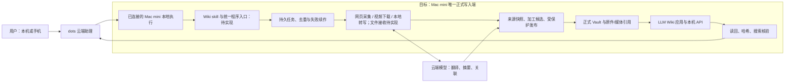

# Wiki 架构与数据草案

## 2026-11-01：dots 与 Mac mini 目标架构

用户已确认通过 dots 接收链接/视频并存入 Mac mini 的 LLM Wiki，暂不迁移飞书入口。本节取代下方历史飞书链路作为本轮部署方向；目录 Schema 的历史草案不因此成为实际迁移要求。

完整执行交接见 [给 dots 的接管说明](docs/handoffs/dots-mac-mini-wiki.md)，源码依据见 [远程库核查](docs/research/llmwiki-remote-library-2026-11-01.md)。



### 数据位置与访问

- 在 Mini 同机运行 LLM Wiki 桌面应用、正式 Vault、Personal Wiki 程序和任务状态。对用户是远程知识库，对写入程序是本地磁盘；本机仅发起、阅读、辅助准备候选和保留回退副本。
- Mini 正式 Vault 为 `/Users/mac/Documents/Personal-Wiki-Vault`；项目为 `/Users/mac/Documents/Personal-Wiki`。视频、音轨和转写保留在 Mini 的 `/Users/mac/Documents/Personal-Wiki-Media`，Vault 保留关联与可核验引用；不把媒体服务成功当作知识发布成功。
- 不同电脑上的同名路径不是同一库。保留 Vault 稳定项目身份，在 Mini 重建本机路径注册与鉴权，不复制整份原电脑 app-state 或凭据。
- 核对版本的 LLM Wiki 支持可选 LAN API；本机桌面界面连接远端后端未证实。本轮采用 dots 连接 Mini，程序调用 Mini 本机 API；网络共享盘双端写入不作为默认方案。
- skill 指导调用，程序执行原件保护、幂等、锁、历史、候选发布和完成核验。生成可在 dots/已有云端模型完成，本地转写不代表全流程零 token。

### 当前交付状态

库、旧业务状态和修复代码已迁入 Mini 并校验，独立依赖及隔离测试通过；Mini 尚未安装注册 LLM Wiki，内容 skill、统一无飞书入口和 dots 真实全链路尚未交付，原电脑仍是生产端。现有媒体接口支持抖音链接；直接视频附件还需独立的接收与转写入口。切换须先暂停原电脑 Wiki 写入并核对最终增量，保留旧任务和回退材料。

## 历史：飞书入口与初期 Schema 草案

飞书 → OpenClaw 路由 → Wiki 领域流程 → 受控归档/知识工具 → Obsidian Markdown 与附件。

此处是实际知识库的结构草案，不是本代码与文档项目的目录要求。Schema 尚未冻结。

2026-09-27 更新：用户要求采用 Karpathy LLM Wiki 模式并优先在已有开源库上迭代。以下目录及字段保留为历史草案；选型时优先复用底座的目录与 Schema，再映射本项目的稳定 ID、原件保护和来源引用要求。

原模式区分原始资料、派生 Wiki 与规则 Schema 三层；资料卡、概念、实体、主题和综合文章是 Wiki 内部的知识类型。参考 [Karpathy 原文](https://gist.github.com/karpathy/442a6bf555914893e9891c11519de94f)。

## Source Schema


```yaml
source_id: SRC-000001
raw_id: RAW-000001
title:
source_type: web
source_url:
author:
publisher:
published_at:
captured_at:
processed_at:
language: zh-CN
topics: []
concepts: []
entities: []
project_ids: []
confidence:
review_status: processed
raw_file:
content_hash:
```


## 知识库目录与资料卡


```text
Personal-Wiki/
├── 00_System/
│   ├── AGENTS.md
│   ├── GEMINI.md
│   ├── Wiki-Schema.md
│   ├── Extraction-Rules.md
│   ├── Review-Rules.md
│   └── Audit/
├── 10_Raw/
│   ├── Web/
│   ├── Audio/
│   ├── Documents/
│   ├── Images/
│   ├── Conversations/
│   └── Feishu/
├── 20_Sources/
│   ├── Articles/
│   ├── Books/
│   ├── Podcasts/
│   ├── Videos/
│   ├── Properties/
│   └── Meetings/
├── 30_Concepts/
├── 40_Topics/
├── 50_Entities/
│   ├── People/
│   ├── Organizations/
│   ├── Products/
│   └── Places/
├── 60_Synthesis/
├── 70_Projects/
├── 80_Reviews/
│   ├── Daily/
│   ├── Weekly/
│   ├── Monthly/
│   └── Quarterly/
├── 90_Outputs/
├── 98_Attic/
└── 99_Attachments/
```

## 默认资料卡正文

```markdown
# 标准化标题

## 一句话结论
## 内容摘要
## 核心观点
## 重要事实与数据
## 关键概念
## 支撑证据
## 不确定或待验证内容
## 与已有知识的关系
## 对我的意义
## 可采取的行动
## 值得继续讨论的问题
## 来源与引用
```

## 原始资料规则

- 原始文件只允许首次写入。
- 同 URL 再次抓取时创建新版本或快照，不覆盖旧版本。
- 使用内容哈希去重。
- 逐字稿属于原始或准原始层，不由主题总结覆盖。
- Raw 删除需要人工明确批准，并保留审计记录。


## 运行与实施建议

先验证原件保存、重复处理、转录、资料卡及主题更新，再加入检索、Review 和行动候选。处理状态要持久化；原件保护、文件锁及幂等由工具执行。Gemini/Codex 的具体路由尚未冻结。
